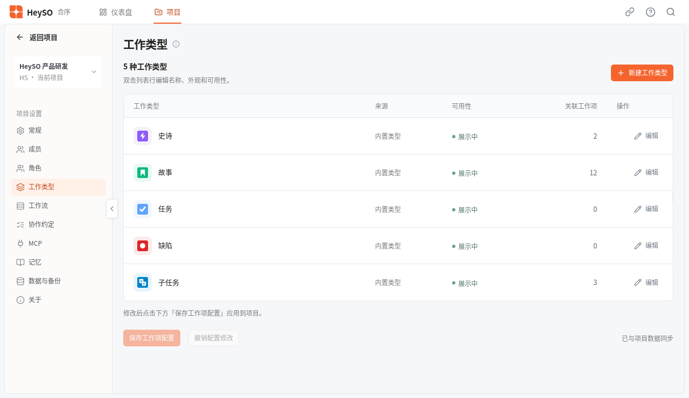
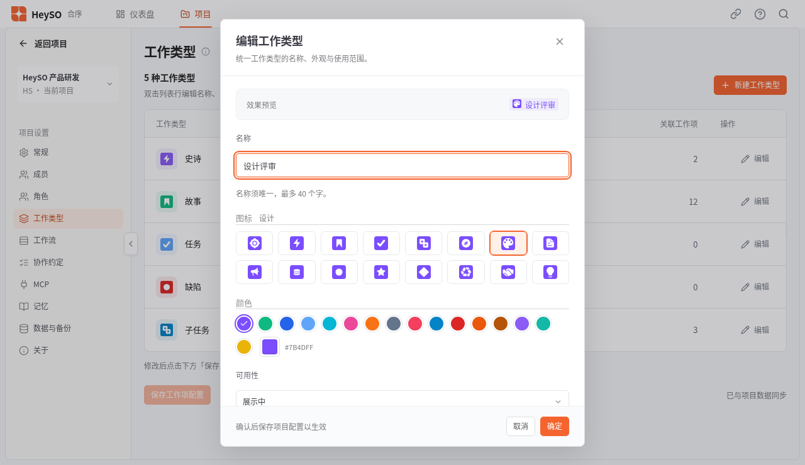
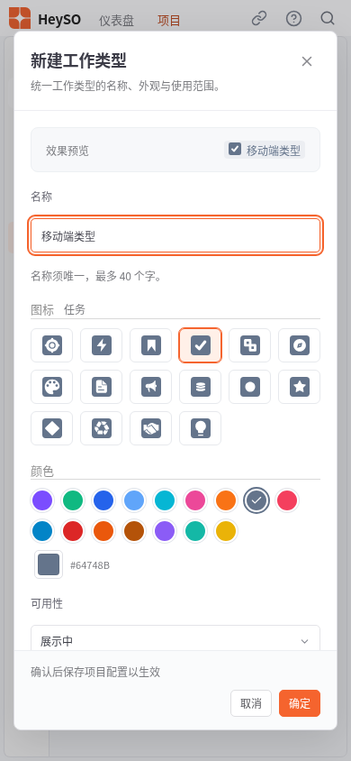

# HS1-36 验收修改

本次只处理人工退回的 HS1-42 与 HS1-51；HS1-33、34、48 等已验收工作保持原状态。

## HS1-42：工作类型列表及编辑页面

验收意见：重新优化 UI 和布局，包括列表页和编辑页面。

- 列表合并重复的图标与名称展示，明确区分来源、可用性、关联工作项及操作。修正旧列宽总和超过 100%、工作项表头逐字换行的问题。
- 列表上方提供数量、双击编辑说明和新建入口；保留双击、Enter/F2 与编辑按钮。
- 编辑窗口提供实时效果预览、图标网格、颜色预设和自定义颜色，统一字段间距与错误反馈。底部固定显示取消、确定及保存项目配置提示。
- 窄屏列表收起来源列；编辑窗口内部滚动，底部按钮保持在视口内。保留重复名称、使用中类型不可停用与至少一种标准类型的保护。

| 桌面列表 | 桌面编辑 |
| --- | --- |
|  |  |

| 窄屏列表 | 窄屏编辑 |
| --- | --- |
|  |  |

## HS1-51：冲刺范围与筛选滚动

验收意见：冲刺只显示进行中的冲刺；点击项目筛选会返回顶部。

- 仪表盘冲刺查询限定 `status === 'active'`，没有匹配的进行中冲刺时显示对应空态。保留完成数量、比例及子任务的冲刺继承计算。
- 浏览器复现：页面滚动至 `scrollY = 300`，打开项目筛选后变成 `0`。原因是下拉搜索输入框在浮层完成定位前使用普通自动聚焦。
- 搜索输入改用 `focus({ preventScroll: true })`。真实浏览器验证打开下拉、输入搜索、选中项目及恢复全部项目后，`scrollY` 均维持 `300`。

## 验证

- `npm test`：294 项通过、0 失败。
- `npm run build`：通过；保留既有 bundle 体积提示。
- 新增 `tests/hs1-36-review-browser.mjs`：进行中冲刺限定、筛选滚动保持、工作类型列宽、图标/颜色选择、实时预览、取消草稿、键盘编辑、390px 窄屏布局、确认按钮可达、新建草稿及刷新不误保存通过，无运行时异常。
- 原 `tests/hs1-36-browser.mjs`：仪表盘详情与刷新、线路版本开关、发布原详情/双击编辑/比例条、工作类型新建保存及刷新通过。

浏览器验证使用独立 `/tmp` 数据目录，截图为本地示例数据。复现命令：

```sh
PORT=4188 HEYSO_DATA_DIR=/tmp/heyso-hs1-review-data node server/index.mjs
HEYSO_PLAYWRIGHT_MODULE=/path/to/playwright-core/index.mjs HEYSO_SCREENSHOT_DIR=/tmp/heyso-review-captures node tests/hs1-36-review-browser.mjs
HEYSO_TEST_URL=http://127.0.0.1:4188 HEYSO_PLAYWRIGHT_MODULE=/path/to/playwright-core/index.mjs node tests/hs1-36-browser.mjs
```

按用户要求将修正提交并同步至 GitHub main；未执行部署。两项重新提交为待人工验收。
