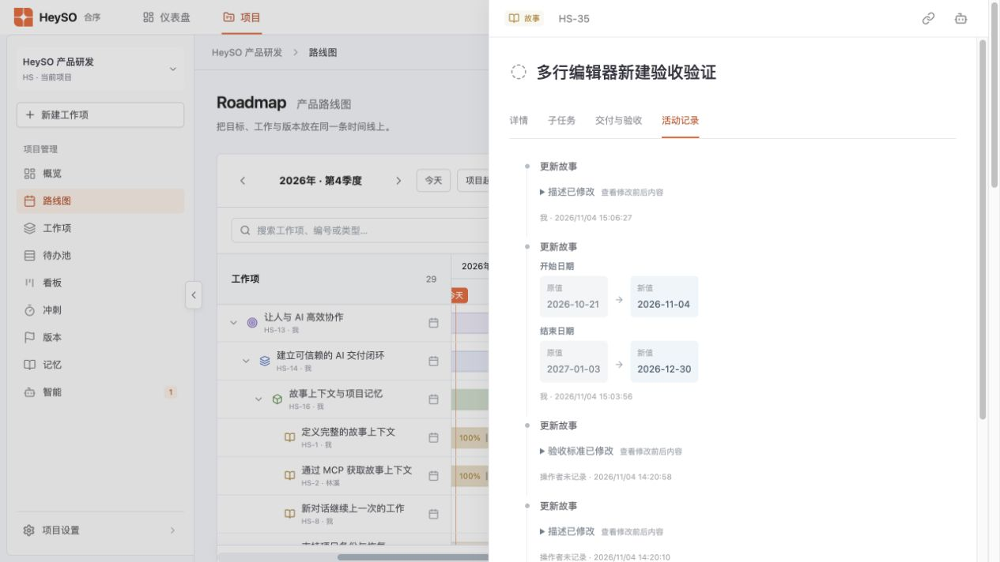
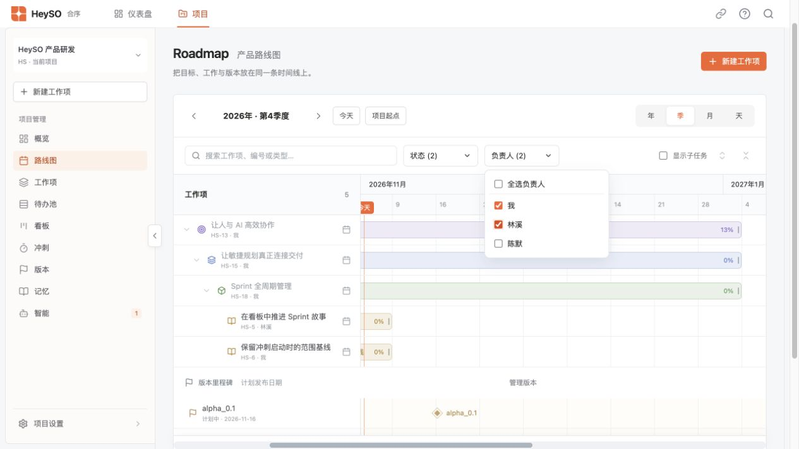
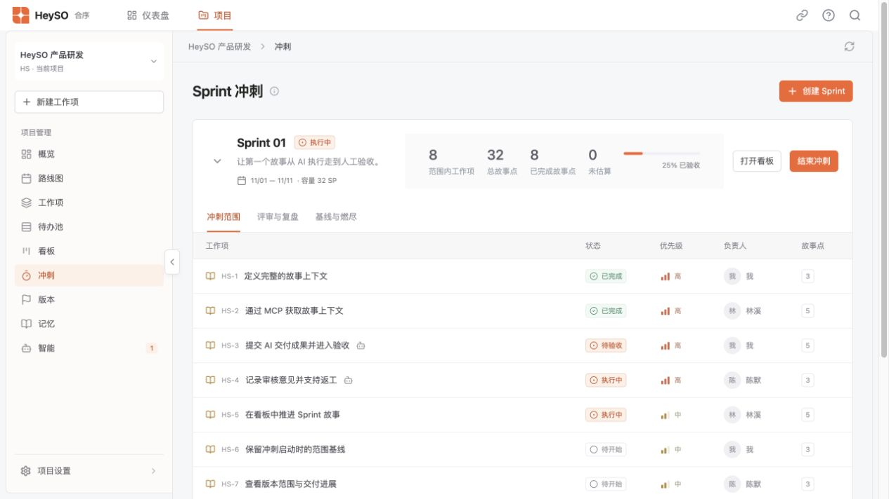

# HS1-1 追加细节优化验证

2026-11-04，本地隔离数据端口 4193。原业务项目未用于界面测试。

- 详情头部左侧为类型和 ID，右侧为链接与 AI 图标；删除版本号、收起图标及旧 AI 开关。等待成功提示后，实际剪贴板内容分别为 `HS-6` 和当前工作项 URL。AI 图标启用/停用权限均成功。
- 标题前保留状态图标，列表、看板、冲刺范围、父级路径及子项列表的类型标识仅显示图标，保留无障碍名称。
- 日期选择后自动保存，短暂停顿合并连续选择；保存失败或父子周期冲突会明确提示，不误报成功。无子项工作项修改为 2026-11-04 至 2026-12-30，刷新及文件回读一致。保留父子周期约束。
- 新活动记录包含操作者、完整年月日时分秒、字段、原值及新值。描述/验收标准/目标默认折叠，展开后读取 Markdown 前后内容。历史记录缺少操作者时明确显示“操作者未记录”。
- 路线图状态与负责人复选，默认全部选中；实测同时选中两个状态及两名负责人，匹配行正确，父级路径保留为上下文。取消全部也有测试覆盖。
- 时间条、日期入口和未排期入口统一打开右侧详情，移除居中编辑弹窗。空白时间轴单击同样打开对应工作项；拖动仍独立保存日期。标题按钮的鼠标背景已移除，保留键盘焦点提示。
- Sprint 四项统计及进度条移入标题栏；DOM 检查两张 Sprint 卡均在 `.sprint-heading` 内包含指标，旧独立指标行不存在。窄屏统计在标题栏内换行。
- HeySO 全量 117 项测试通过，包含新增多选、AI 继承权限独立停用、操作者及时间验证。云端 13 项测试通过，验证操作者来自认证账号，不能由客户端伪造。

云端发布与线上权限/操作者验证结果在发布后补充。
