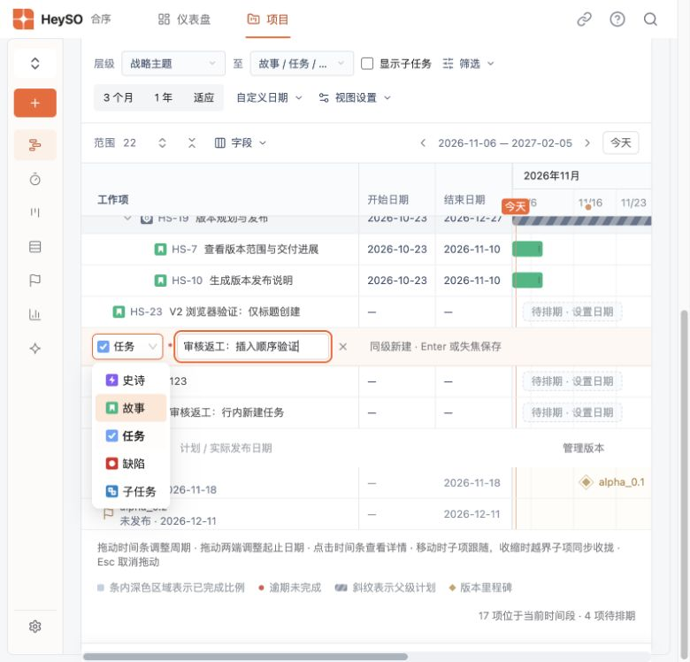
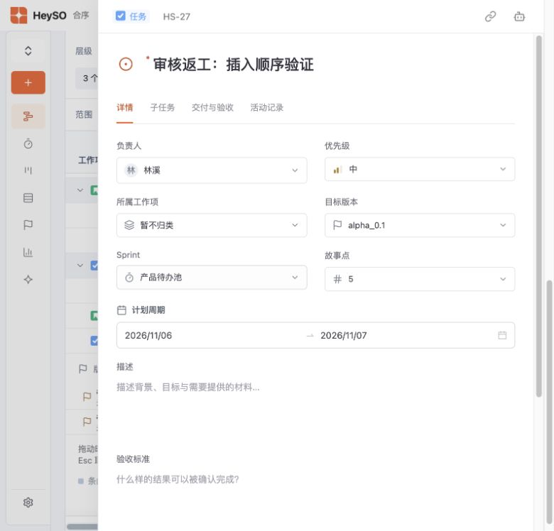
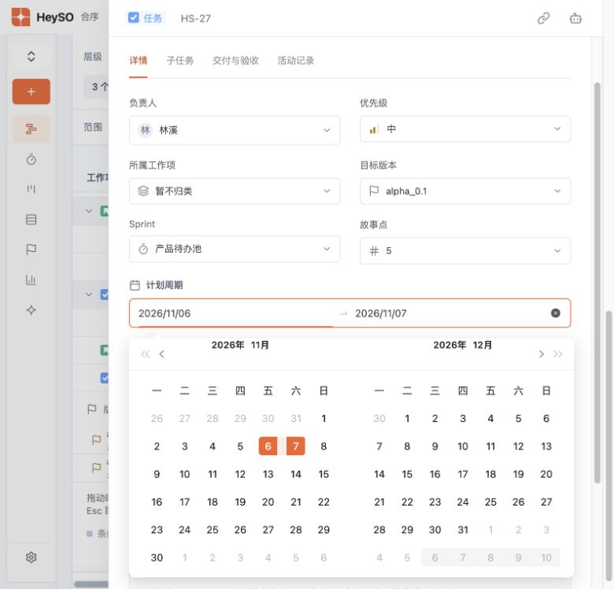

# HS1-12 · 小细节优化 V2

2026-11-06。包含初次实现及人工审核后的交互修订，交付后由负责人验收。

## 行为

- 线路行悬停/聚焦时，标题格右侧出现加号；点击展开行内类型与标题，失焦或 Enter 保存，Esc 取消。空标题不保存，失败保留草稿并支持重试。
- 同层类型创建同级项，更低层类型按规则关联父级；插入顺序持久保留，新建子任务展开父级并显示子任务层。
- 点击标题打开详情；日期、状态、负责人、版本及故事点列直接编辑并保存。保留日期边界、状态转换和并发校验。
- 工作项业务字段仅标题必填，创建及详情显示红色星号。类型可使用默认值，负责人、日期和父级可后补；子任务交付及 AI 执行前须补全父级。
- 计划周期删除重复标签及上下边框，统一间距；采用品牌橙色双月范围选择器，支持留空、单端日期和清空。
- 保留工作项列宽调整、个人筛选偏好和长子任务标题下的完整状态显示。

## 验证

- `npm test`：198 项通过。
- `npm run build`：通过；保留既有大包体积提醒。
- LoyoCloud 关联回归：`node --test tests/heyso.test.mjs tests/heyso-save.test.mjs`，9 项通过。
- 独立临时工作空间中验证类型切换、失焦只创建一次、插入顺序、空标题、取消、子任务父级，以及六类字段编辑和刷新持久化。
- 计划周期实测上下边框 0 px、标题与选择器间距 8 px、重复标签 0 个、内部输入边框 0 px。

LoyoCloud 独立部署；修改领域规则后使用 `node scripts/sync-cloud-core.mjs` 同步服务端副本。

## 截图

