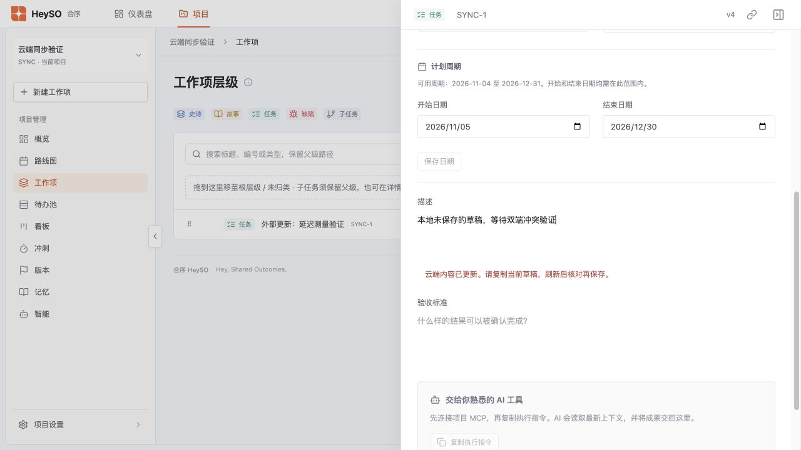

# HS1-4 云端保存与刷新优化

## 实现

工作项保存按当前项目文件提交，用 headId 做并发校验，直接合并云端确认返回的内容和新 headId。常规新增/修改不再在保存前后下载全部项目；旧客户端请求仍兼容。项目名称/编号等全局标识变更保留全局校验，导入和初次加载保留完整读取。

刷新只读取文件清单和版本，只下载变化的项目；移除已删除文件。保存进入串行队列，使用最新确认版本；较早启动的刷新不能覆盖后续保存或恢复结果。网络中断最多自动重试一次，重用完全相同的 requestId 和请求内容。保存中、确认成功、失败、冲突和登录过期分别反馈。

持续前台每 2 秒检查一次元数据；后台停止轮询，回到前台、窗口获得焦点、恢复联网时立即检查。正常网络下最长可见延迟为 2 秒加版本检查和变化文件下载耗时，网络异常期间不保证上限，恢复后自动重试。两个真实页面实测可见延迟 1267 ms，见 [记录](hs1-4-live-sync.json)。

描述、标题与日期编辑期间收到同字段外部修改时保留草稿并提示核对；快速编辑弹窗在工作项版本改变后阻止覆盖。未收到云端确认前不显示“已保存”。

## 测量方法

基线为 b047a10 的保存链路；新旧处理器在同一台机器执行，访问相同正式云端部署 `cloud.loyo.work`、LoyoCloud 0.0.13-bate.2，使用同一隔离账号、同一组测试项目。每场景每类操作各 30 次/实现，共 360 次；每轮交换执行顺序。场景共享逐渐增长的数据，交替执行减轻增长及网络漂移偏差。每个项目预置 30 个任务与固定描述，测试新增及修改标题、描述、状态、负责人、日期。

计时包含处理器到云端的完整请求链、JSON 解析和返回响应构造，不包含浏览器绘制及 Netlify 网关入口延迟。成功云端 HTTP 调用数包含清单、下载和写入；网络中断尝试另记，重试等待计入耗时。传输量为解码后的 JSON 请求/响应字节，不包含 HTTP 头及压缩传输收益。P95 取排序后第 ceil(0.95×30) 个样本，无异常样本剔除。

正式测试首次遇到测试账号 5 MiB 容量限制，按要求记录失败；用户扩容后重测。测试中遇到临时网络中断，重试保留同一请求内容；原始耗时包括恢复时间。测试文件仅移入回收站，不永久删除。

## 内部阶段定位（隔离环境）

同一应用版本在隔离 PGlite 服务中，增加固定 50 ms/云端请求的延迟，完成同样 360 次样本。该数据用于分离应用阶段，不作为正式 PostgreSQL 或公网延迟结论，见 [隔离样本](hs1-4-cloud-lab-benchmark.json)。

快照压缩中位数约 5–9 ms，容量统计约 2–14 ms；本轮未修改云端快照、配额、历史保留或数据库逻辑。直接移除全量读取的收益已经由请求数和正式云端对比单独验证。并发读取阶段的累计时间是各请求耗时之和，不是墙钟关键路径时间。

## 功能与安全验证

- HeySO 全量 117 项测试通过；Netlify/Vercel/Cloudflare 三种部署入口覆盖快速保存与增量刷新；生产构建和 Cloudflare dry-run 通过。
- 两个真实云端页面验证状态同步；本地草稿在外部同字段修改后保留并明确提示冲突。正式云端新建和快速编辑 Markdown 内容，刷新后一致。
- 正式云端各项目场景重新读取后内容一致，同 requestId 重发只创建一次，旧 head 的另一个请求返回冲突。
- 可控网络测试覆盖确认丢失后的相同请求重试、持续失败不显示成功、断网后恢复、401 登录过期、旧刷新与连续写入交错。登录过期清理配置在三种部署入口测试中验证。
- LoyoCloud 同版本 13 项回归全部通过，包含容量不足回滚、历史版本读取/恢复、并发冲突、租户隔离及会话撤销。没有变更存储算法。

## 正式云端对比

| 项目数 | 操作 | 中位数：原→新 | 降低 | P95：原→新 | 请求数：原→新 | JSON 字节：原→新 |
|---|---|---|---|---|---|---|
| 1 | 新增 | 4.12s → 1.08s | 73.8% | 8.00s → 1.49s | 5.0 → 1.0 | 576,160 → 194,150 |
| 1 | 修改 | 5.77s → 1.77s | 69.3% | 6.62s → 4.52s | 5.0 → 1.0 | 982,895 → 329,174 |
| 5 | 新增 | 9.68s → 1.40s | 85.6% | 13.49s → 2.46s | 13.0 → 1.0 | 1,396,776 → 194,150 |
| 5 | 修改 | 9.98s → 1.70s | 83.0% | 12.13s → 2.02s | 13.0 → 1.0 | 1,803,511 → 329,174 |
| 10 | 新增 | 14.95s → 1.42s | 90.5% | 22.68s → 2.22s | 23.0 → 1.0 | 2,422,691 → 194,155 |
| 10 | 修改 | 17.16s → 1.83s | 89.3% | 21.19s → 5.10s | 23.0 → 1.0 | 2,829,426 → 329,179 |

[正式云端原始360条样本](hs1-4-cloud-production-benchmark.json)。全部场景达到至少30次/类/实现，多项目中位数下降超过30%，P95均低于基线。中位数在偶数样本时取中间两数均值。

10项目阶段再次触及扩容后的50MiB配额后暂停；用户明确授权永久清理清单内8个已结束的隔离性能文件，空间从约49.97MiB降至3.23MiB。保留并恢复原10个场景文件，从275条检查点继续，最终360条完整样本，无样本剔除。后续文件仍仅移入回收站。
