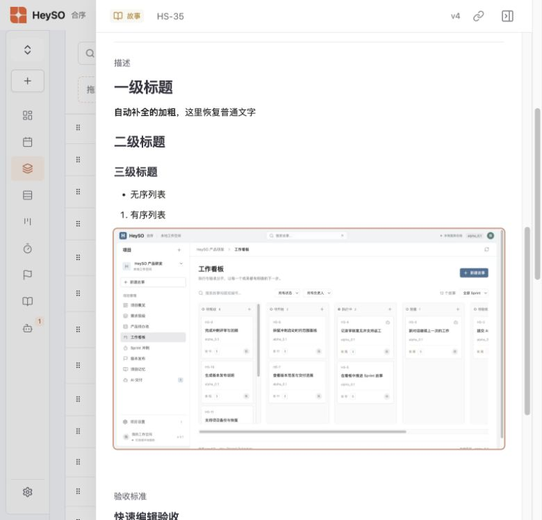

# HS1-8 多行文本框验证

2026-11-04，本地隔离工作空间，构建版端口 4189。

- 工作项详情、新建工作项、快速编辑与历史快照统一使用「描述」「验收标准」。
- 支持 H1/H2/H3、粗体、无序和有序列表。按用户后续要求，去掉工具栏、编辑框边框及编辑/预览切换，直接在格式化内容中输入。
- 实际逐键输入 `# `、`## `、`### `、`- `、`1. ` 均即时转换；输入 `**` 自动进入加粗并在序列化时补齐闭合标记，再次输入 `**` 恢复普通文字。已核对普通文字没有留在粗体范围内。
- 通过真实系统剪贴板粘贴 PNG，压缩为 1265×712 WebP 并保存在 Markdown 中。保存后重新加载，图片和格式均保留；预览图片成功加载。
- 新建工作项的描述和验收标准保存成功；快速编辑验收标准后重新加载仍一致。
- 图片限制为常见位图，单张压缩后不超过 256 KiB；文本总长最多 1 MiB。处理中禁止重复插入和表单提交，失焦后在处理完成时保存。
- 渲染不执行原始 HTML，阻止脚本链接和 SVG data URL。
- 自动化测试覆盖语法、安全 URL、行内解析/序列化及存储/导入导出；当前工作区全量 114 项通过（其中 4 项属于云端同步优化）。生产构建通过，行内编辑器独立延迟加载，主包约 516 kB，既有体积提示仍存在。

本次验证没有修改真实项目的描述或验收标准。云端沿用既有字符串字段存储，未变更文件格式或存储协议。
