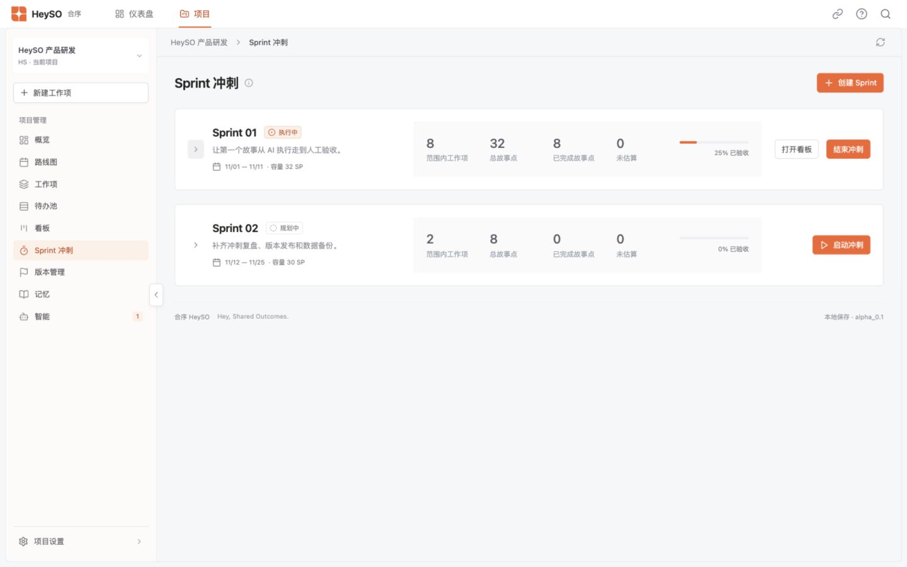

# 页面布局与筛选调整验证

2026-11-04，本地隔离工作空间（端口 4193）。

- Sprint 两张卡的指标背景、标签及数字颜色一致；桌面 1440px 下指标区左侧位置与各列起点完全一致。固定操作区宽度，避免不同按钮数量导致指标位移。
- 路线图负责人支持搜索；输入“林”仅显示“林溪”，无匹配时显示空状态，保留原有多选功能。
- 九个项目菜单名称与页面标题逐项一致；路线图使用与其他页面相同的标题、说明图标和主操作结构。
- 待办池标题和工具栏共同吸顶。滚动 478px 后，吸顶容器顶部为 44px，标题与工具栏均保持可见。
- 版本分类为全部、已发布、未发布，首次默认未发布。隔离数据中分别显示 2、1、1 个版本，切换结果正确。
- 项目下拉选项移除项目图标，实际检查选项内项目图标数量为 0；保留选中提示及侧栏收起时的项目切换图标。
- 生产构建及差异格式检查通过。

